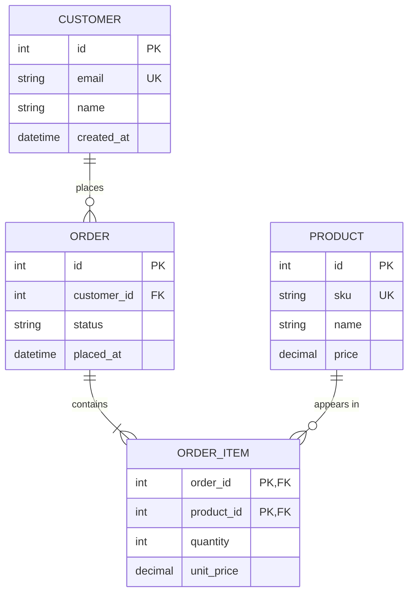

# Mode: data-model

Use for data-product asks. Commit decisions that the evidence supports; reuse `/brainstorm` findings, revalidating when stale.

## Specify
- **Grain** of each table, stated as one sentence ("one row per order line per day").
- **Keys**: business key, surrogate key, and proof of uniqueness (duplicate count query and result).
- **Cardinalities** and join completeness (FULL OUTER JOIN match/orphan counts).
- **Source mappings** column by column, with transformations and quality rules.
- **History behavior** (overwrite, SCD2, snapshot).
- **Medallion placement**: bronze raw with provenance, silver enriched, gold curated. Apply only where relevant.
- **Downstream**: semantic model relationships, measures, and report changes.

## Before/after
Show current and proposed schemas and relationships using the ER diagrams below; use accompanying tables for transformations and column-level changes. Mark each table/column create/update/remove/no-change.

## ER diagrams
Include fenced Mermaid `erDiagram` blocks labeled **Before** (observed baseline, with revision) and **After (proposed)** (selected design, not deployed state). For a new model, say "Before: not present"; if baseline definitions cannot be read, say "Before: unavailable" rather than inventing an empty model.

Show entities, attributes with known types, PK/FK/UK roles (including composite keys), and named relationships with cardinalities. Key markers describe evidenced or explicitly proposed roles, not proof of enforced constraints. Use Mermaid-safe identifiers and map them to source names in notes.

Record unknown types, key roles, or cardinalities beneath the diagram; omit unsupported detail rather than inventing it. Explicitly distinguish proposed decisions from observed facts. Unresolved consequential choices still block readiness. Do not claim rendering was checked unless a renderer was used.

Synthetic example only; replace it with the story's evidenced or explicitly proposed design:

## Seam
Normally the semantic model measure over gold. Draft contract checks:
- Gold row counts equal reconciled source counts.
- Key uniqueness: `COUNT(*) - COUNT(DISTINCT key) = 0`.
- DAX measure example: `EVALUATE ROW("Total Sales", [Total Sales])` equals a known value for a fixed date window.

## Contradictions
Duplicate keys, grain mismatch, or incomplete joins reopen the decision: ask one question with a recommended answer (for example, dedupe by latest `modified_at` versus change the grain). Do not tag ready until resolved.
