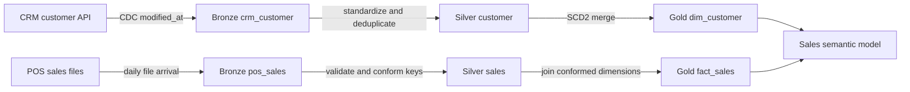
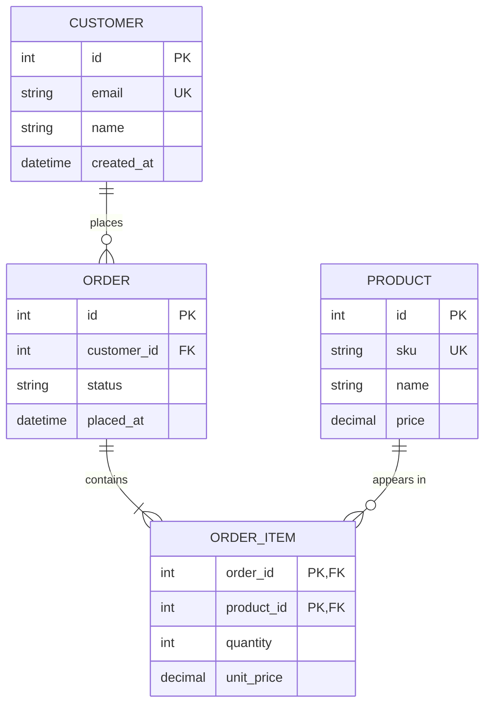
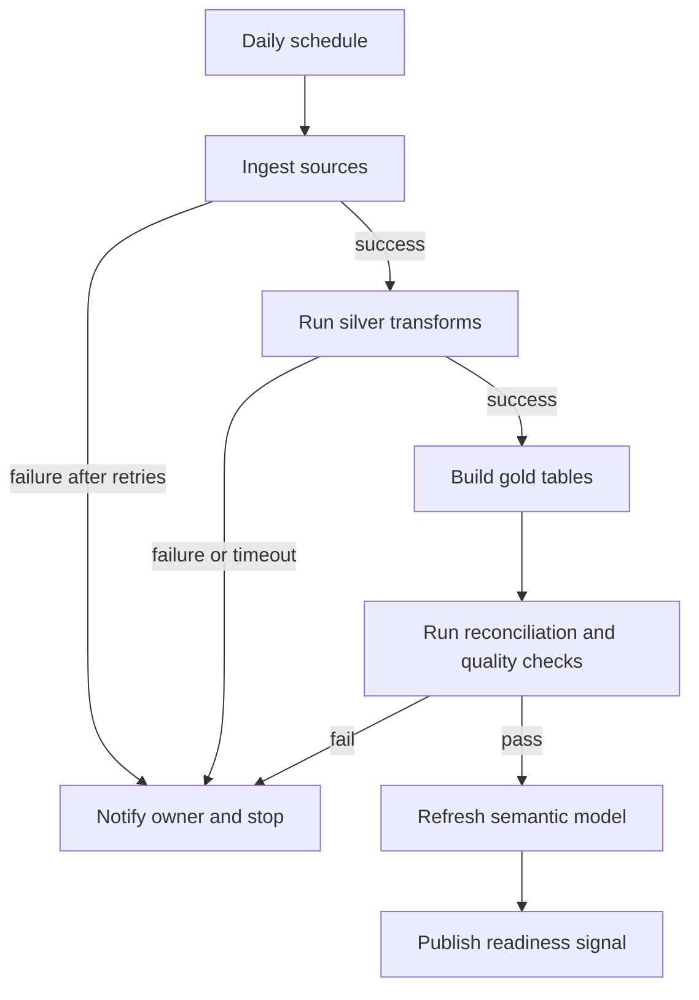

# Mode: data-product

Use for a new or changed data product. Specify the path from evidenced sources to the serving interface and selected Seam without forcing irrelevant diagrams.

## Documentation views

Select every consequential view and state why an expected view is omitted.

| View | Use when | Must answer | Preferred format |
| --- | --- | --- | --- |
| Source and ingestion | A source, capture method, or landing contract changes | Owner, entity, extraction method, cadence/event, watermark/CDC, schema, volume/sensitivity, landing target | Source table plus flowchart |
| Transformation and lineage | Data is cleaned, joined, enriched, aggregated, or moved between layers | Owning artifact/engine, input/output grain, rule, rejects, quality and reconciliation | Lineage flowchart plus mapping table |
| Data model | Gold tables, warehouse objects, or semantic relationships change | Grain, facts/dimensions, business/surrogate keys, history, cardinality, measures | Before/after ER diagrams |
| Pipeline orchestration | Activities, schedules, dependencies, or recovery change | Trigger, parameters, dependency conditions, retries, timeout, idempotency, backfill, failure path | Orchestration flowchart plus run contract |
| Serving and operations | Consumers, freshness, monitoring, or support behavior changes | Interface, consumers, SLA/SLO, refresh, ownership, alerting, replay/rollback, Seam | Context table |

Across views:
- Label observed baseline, proposed decision, and unknown detail explicitly.
- Use stable artifact names and identify the Fabric item type and workspace/environment.
- Trace each source to its transformations, orchestration owner, serving surface, and Seam.
- Reuse one diagram when it answers multiple views; do not duplicate detail for template compliance.
- Never infer source ownership, business rules, sensitivity, volume, or freshness.

## Source, ingestion, transformation, and lineage

Record source-to-target mappings column by column where contracts change. State medallion placement only when used: bronze preserves source fidelity and provenance, silver applies reusable quality/conformance, and gold serves stable business grain.

Synthetic proposed-model example only:

| Source | Target | Target grain | Transformation | Quality/reconciliation |
| --- | --- | --- | --- | --- |
| `crm_customer` | `silver.customer` | One row per source customer | Normalize email; latest `modified_at` wins | Null business keys quarantined; input = accepted + rejected |
| `pos_sales` | `gold.fact_sales` | One row per sale line | Parse currency; resolve conformed keys | Daily amount and row count reconcile to accepted silver rows |

## Data model

State one sentence of grain per table. Identify business, surrogate, primary, foreign, and unique keys; history behavior; proof of uniqueness; join completeness; and downstream semantic measures.

Include fenced Mermaid `erDiagram` blocks labeled **Before** and **After (proposed)**. For a new model, say **Before: not present**; if definitions cannot be read, say **Before: unavailable**. Show known types, PK/FK/UK roles including composite keys, and labeled cardinalities. List unknowns beneath the diagram and never treat a proposed key as an enforced constraint.

Synthetic example only:

## Pipeline orchestration

Document the run path rather than only listing activities. Include success, failure, timeout, retry, and notification edges; identify parameter and backfill behavior. State how reruns avoid duplicate or partial output.

Synthetic example only:

## Serving, operations, and Seam

Name the serving interface (for example SQL endpoint, semantic model, API, or file contract), consumers, freshness target, support owner, monitoring source, alert threshold, replay path, and rollback boundary.

| Serving interface | Consumers | Freshness | Owner and monitoring | Replay/rollback | Seam |
| --- | --- | --- | --- | --- | --- |
| `Sales semantic model` | Finance dashboard and analysts | Ready by 07:00 UTC daily | Data Engineering; alert when quality or refresh fails | Rerun one business-date partition; restore prior gold version if reconciliation fails | `[Net Sales]` for the agreed business date |

Normally choose the highest-level observable product result as the Seam, such as a semantic model measure over reconciled gold data. The draft Verification Contract should include:
- Source-to-target reconciliation for a fixed partition/window.
- Gold row counts and rejects/quarantine counts.
- Key uniqueness and required join completeness.
- A SQL or DAX business measure against an independently known value.
- The same narrow parameter/window used for implementation feedback and final verification.

Duplicate keys, grain mismatch, incomplete joins, unowned failures, or an untraceable source-to-Seam path reopen a decision. Ask one question with a recommended answer and do not tag ready until resolved.
