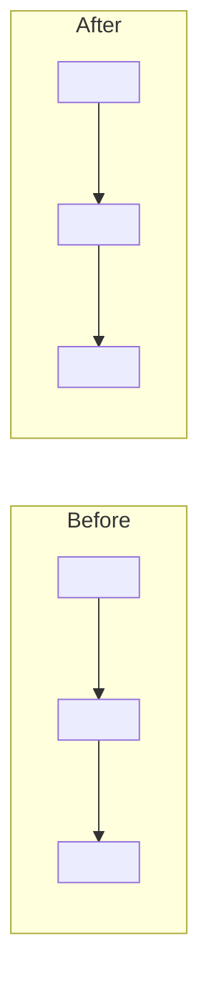

# PR brief: <repository> !<pr-id> — <PR title>

- Status: <active|completed|abandoned> | Review version: iteration <n>
- Baseline: target `<commit>` → source `<commit>` (native review diff)
- Links: PR <url>; story <url or "none supplied">
- Coverage: <files reviewed / total>; unavailable, generated, binary, or truncated: <list or "none">

## What changed
<Two to five plain sentences: what is different and, if a source states it, why. Say "Intent not stated" if unknown.>

## Before and after

Notes: <what moved, was added, or was removed>

## Impact
| Artifact or consumer | Relationship | Basis | Effect |
| --- | --- | --- | --- |
| <name> | direct / downstream | evidenced / inferred / unknown | <effect> |

## Intended versus verified
| Intent or criterion | Source | Verified? | Evidence |
| --- | --- | --- | --- |
| <criterion> | <story / approach> | yes / no / not checked | <link or "static review only"> |

## Limits
<Inferences made, unknowns, access gaps, and that Mermaid is unrendered unless checked. No runtime success is claimed from static changes.>
